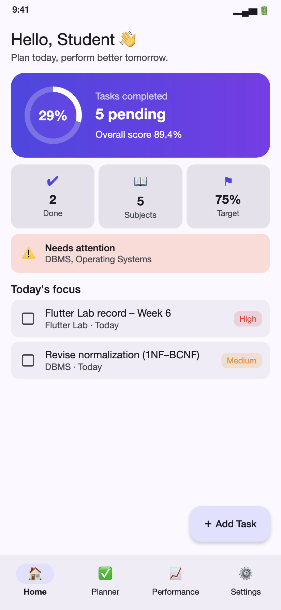
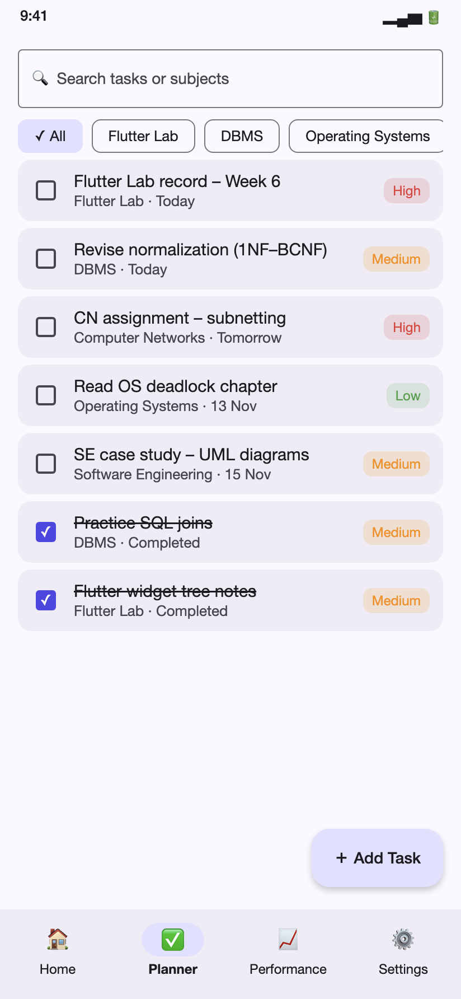
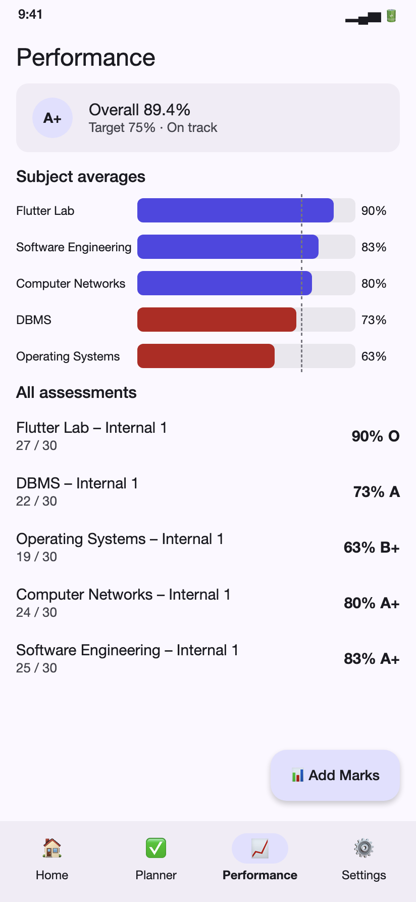
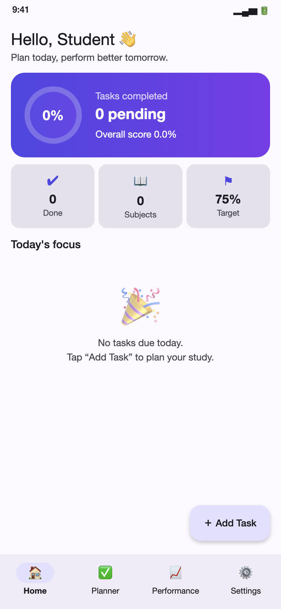
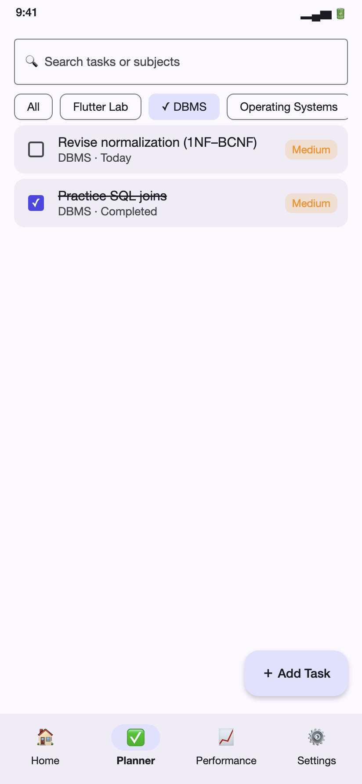
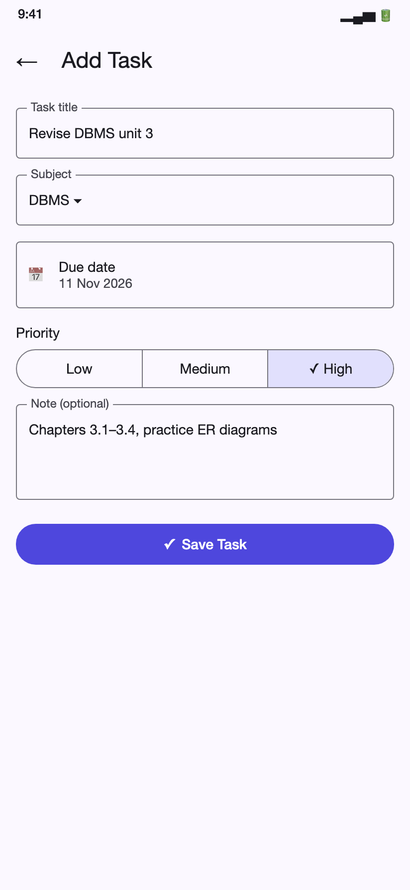
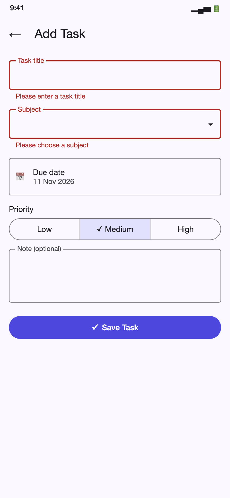
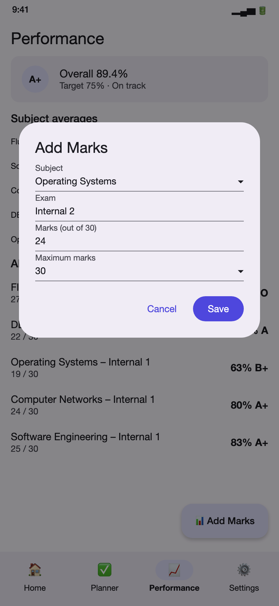
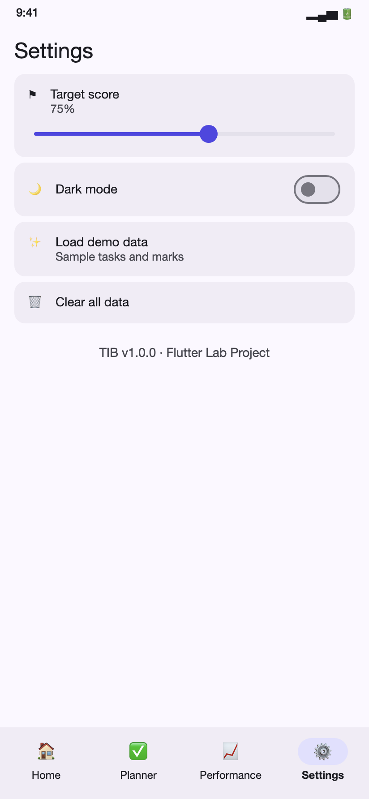
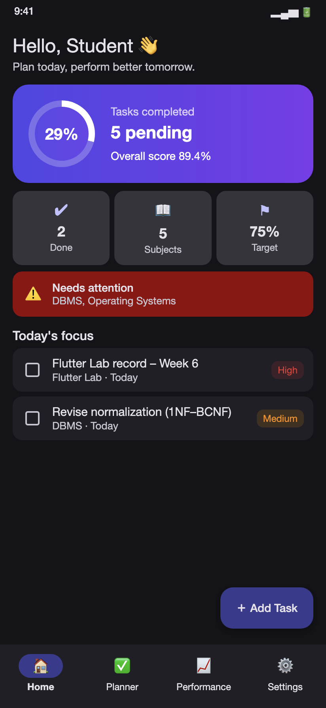

# TIB – Student Planning and Performance Tracking App 📚📊

   


A simple **Flutter** app that helps students **plan academic tasks** and **track their performance** in each subject.
Built as part of the **Flutter Lab** (B.Tech CSE, III Year, ACE Engineering College).

<p align="center">
  
  
  
</p>

## ✨ Features

- **Dashboard** – today's tasks, completion ring, overall score and “needs attention” subjects
- **Planner** – add / edit / complete tasks with subject, due date and priority
- **Search & filter** – search by text and filter by subject; swipe to delete with **Undo**
- **Performance** – enter exam marks, see subject averages in a custom bar chart, grades (O, A+, A …)
- **Target score** – subjects below your target are highlighted
- **Settings** – target slider, dark mode, demo data, clear data
- **Offline** – everything is saved on the device with `shared_preferences`

## 📱 How to use

1. Open **Settings → Load demo data** to explore the app.
2. Tap **Add Task** to plan an assignment, revision or lab record.
3. Tick tasks when done – the dashboard ring updates instantly.
4. Add exam marks in **Performance** to see averages, grades and weak subjects.

More details: [docs/user_guide.md](docs/user_guide.md)

## 🖼️ Screenshots

| Empty state | Dashboard | Planner | Filter |
|---|---|---|---|
|  |  |  |  |

| Add task | Validation | Performance | Add marks |
|---|---|---|---|
|  |  |  |  |

| Settings | Dark mode |
|---|---|
|  |  |

## 🏗️ Architecture

```
Screens (UI)  ──►  PlannerController (ChangeNotifier)  ──►  StorageService (shared_preferences)
     ▲                         │
     └──── ListenableBuilder ◄─┘  notifyListeners()
```

```
lib/
├── main.dart                 # loads saved data and starts the app
├── app.dart                  # MaterialApp + light/dark theme
├── models/                   # study_task.dart, subject_score.dart
├── services/                 # storage_service.dart
├── state/                    # planner_controller.dart
├── data/                     # sample_data.dart
├── theme/                    # app_theme.dart
├── utils/                    # date_utils.dart, validators.dart
├── widgets/                  # summary_card, task_tile, stat_tile, empty_state, score_bar_chart
└── screens/                  # home_shell, dashboard, planner, add_task, performance, settings
test/                         # model_test, controller_test, widget_test
```

## 🚀 Getting started

```bash
git clone https://github.com/acharitha001-crypto/TIB-Flutter.git
cd TIB-Flutter
flutter create .        # generates android/ios/web folders (first time only)
flutter pub get
flutter run -d chrome   # or any Android / iOS device
```

Run the tests:

```bash
flutter analyze
flutter test
```

## ✅ Tests

| Area | What is tested |
|---|---|
| Models | JSON round trip, priority fallback, percentage |
| Utils | Grades, due labels, validators |
| Controller | Add / toggle / delete, averages, weak subjects, persistence, search |
| Widgets | Empty state, form validation, adding a task |

See [docs/testing.md](docs/testing.md) for the full test plan.

## 🛠️ Tech stack

Flutter · Dart · Material 3 · shared_preferences · flutter_test · GitHub Actions

## 🔮 Future scope

- Deadline reminders and notifications
- Cloud sync with Firebase
- Weekly timetable and Pomodoro timer
- SGPA / CGPA calculator

## 👤 Author

**Abbagoni Charitha** – 24AG1A0501, B.Tech CSE (III Year), ACE Engineering College, Hyderabad

## 📄 License

MIT
